<div align="center">

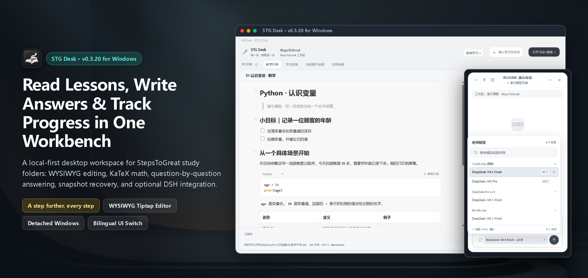

<h1>STG Desk</h1>

<p><strong>A step further, every step. A local-first Windows desktop workbench for <a href="https://github.com/wildcat430524/StepsToGreat">StepsToGreat</a> study folders.</strong></p>

<p>
  <a href="https://github.com/wildcat430524/STG-Desk/releases/latest"></a>
  <a href="https://github.com/wildcat430524/STG-Desk/actions/workflows/ci.yml"></a>
  <a href="https://github.com/wildcat430524/STG-Desk/releases"></a>
  
  <a href="LICENSE"></a>
</p>

<p>
  <strong><a href="https://github.com/wildcat430524/STG-Desk/releases/latest">Download for Windows (v0.3.20)</a></strong> ·
  <a href="#feature-gallery">Screenshots</a> ·
  <a href="#local-first-architecture">Architecture</a> ·
  <a href="#30-second-quick-start">Quick Start</a> ·
  <a href="#dsh-integration">DSH Chat</a> ·
  <a href="#stepstogreat-ecosystem">Ecosystem</a>
</p>

<p><a href="README.md">简体中文</a> | <strong>English</strong></p>

</div>

---

STG Desk gives your Markdown-driven self-study workflow a dedicated desktop workbench: open any local **StepsToGreat** folder to jump straight to your current lesson, edit teaching guides and answers side-by-side, check past evaluations and overall progress, and connect on-demand to **DeepSeek Harness (DSH)** for native AI tutoring sessions.

> **Local-first, zero lock-in**: reading, editing, and answering work completely offline and write straight back to your original Markdown directory. Covers [v0.3.20](https://github.com/wildcat430524/STG-Desk/releases/tag/v0.3.20) ([all release notes](https://github.com/wildcat430524/STG-Desk/releases)).

---

## Local-First Architecture

<p align="center">
  <picture>
    <source media="(prefers-color-scheme: dark)" srcset="docs/assets/architecture-en-dark.png">
    <source media="(prefers-color-scheme: light)" srcset="docs/assets/architecture-en-light.png">
    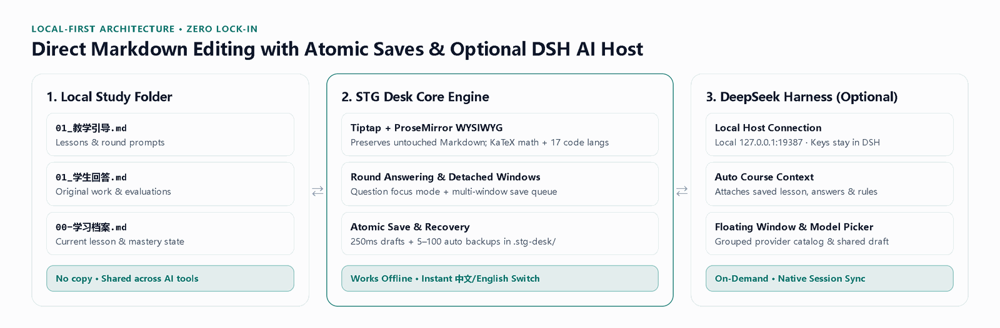
  </picture>
</p>

- **Zero file duplication**: works directly on your existing study directory, keeping everything compatible with Codex, Claude Code, Cursor, or DSH.
- **v0.3.20 Bilingual UI Switch**: switch **中文 / English** in the top bar anytime—persisted locally, synced across detached/floating windows, without reloading or losing drafts, while keeping course Markdown untouched.

---

## Feature Gallery

<table>
  <tr>
    <td width="50%" valign="top">
      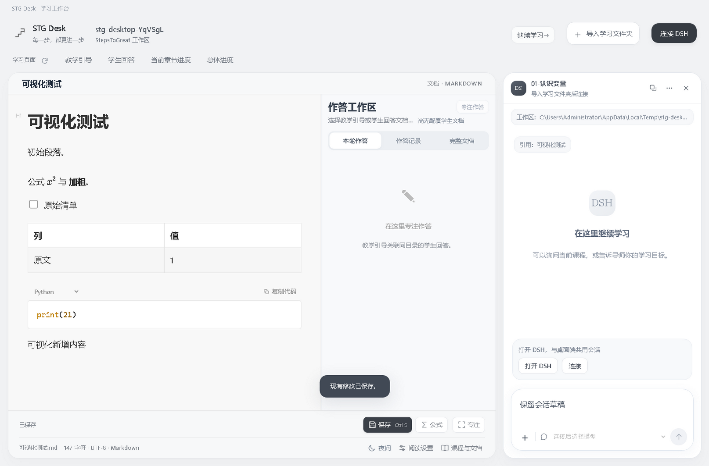<br>
      <sub><strong>Direct WYSIWYG Editing.</strong> Click headings, checklists, tables, or math to edit in place while preserving untouched Markdown blocks. Includes font/width controls, night theme, and <code>Esc</code> focus mode.</sub>
    </td>
    <td width="50%" valign="top">
      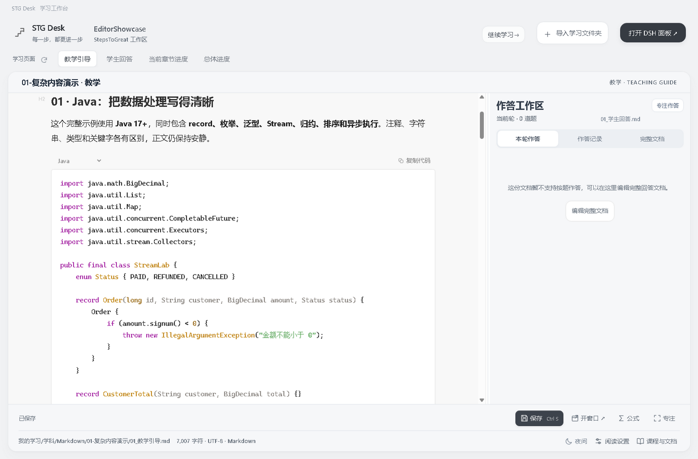<br>
      <sub><strong>17 Languages + One-Click Copy.</strong> Unified highlight.js (Atom One Light/Dark) styling across editing and preview; code toolbars are ProseMirror decorations and never pollute your Markdown files.</sub>
    </td>
  </tr>
  <tr>
    <td width="50%" valign="top">
      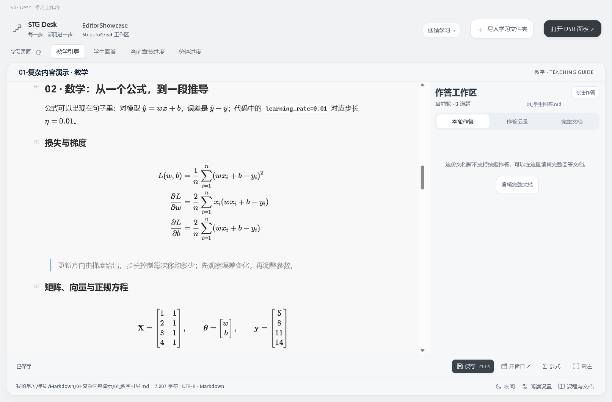<br>
      <sub><strong>Live KaTeX Math & Error Guard.</strong> Supports inline <code>$...$</code> and display <code>$$...$$</code> formulas with live insertion preview and double-click source editing. Invalid LaTeX stays intact.</sub>
    </td>
    <td width="50%" valign="top">
      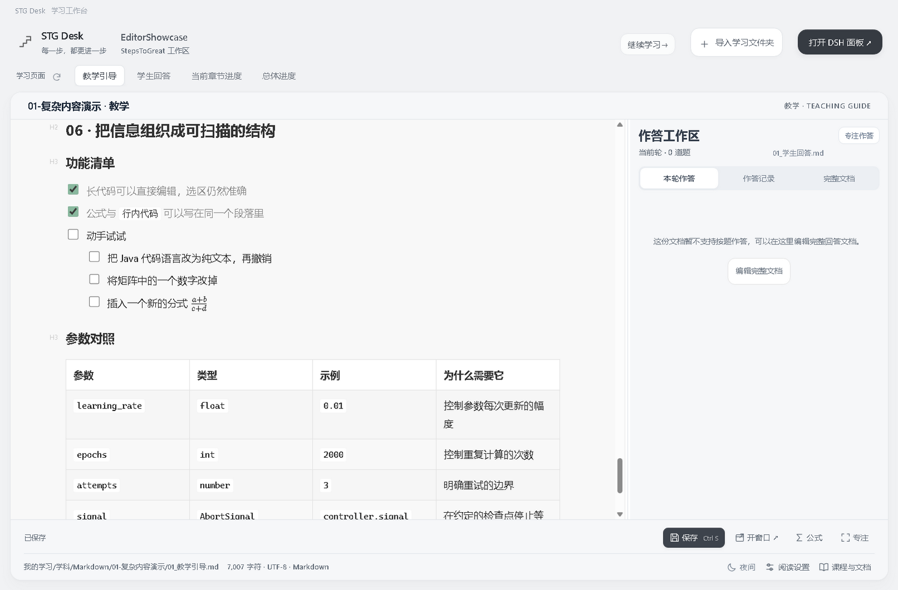<br>
      <sub><strong>Structured Long-Form Docs.</strong> Margin depth tags (<code>H1</code>/<code>H2</code>/<code>H3</code>), nested checklists, and editable tables—explore the bundled <code>demo/EditorShowcase</code> workspace to test them all.</sub>
    </td>
  </tr>
  <tr>
    <td width="50%" valign="top">
      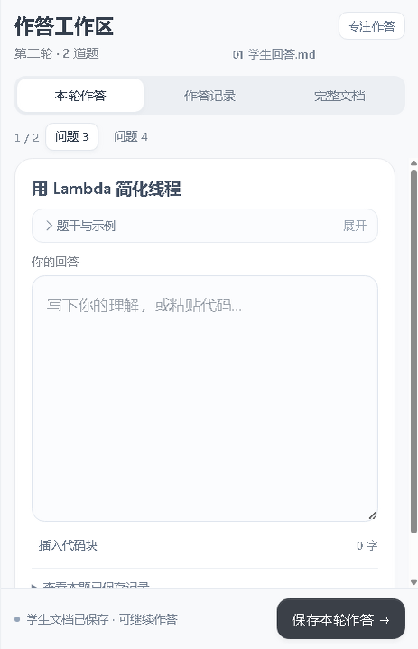<br>
      <sub><strong>Question-by-Question Answering.</strong> Switch questions while retaining drafts, expand/collapse long prompts, zoom into Focus Answer mode, or inspect past evaluations and full answer Markdown.</sub>
    </td>
    <td width="50%" valign="top">
      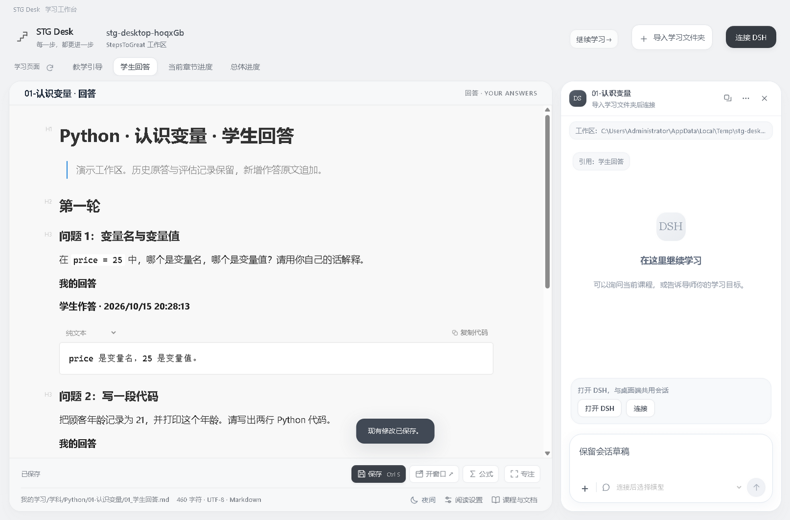<br>
      <sub><strong>Clean Atomic Saves.</strong> Save question answers, full answer edits, and teaching edits together via <code>Ctrl+S</code>—never silently alters mastery tables or handoff state.</sub>
    </td>
  </tr>
  <tr>
    <td width="50%" valign="top">
      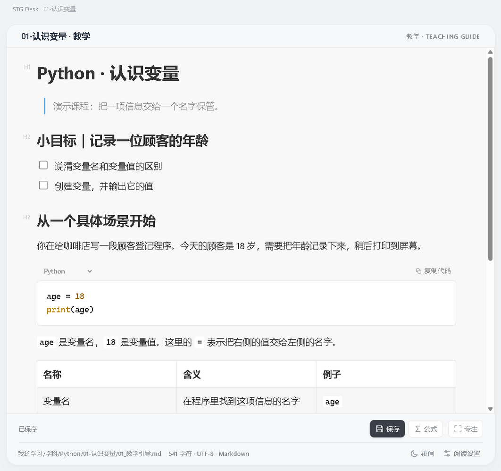<br>
      <sub><strong>Detached Multi-Window Study.</strong> Pop out the lesson or answer doc into its own window to read and write across monitors while sharing a single safe write queue.</sub>
    </td>
    <td width="50%" valign="top">
      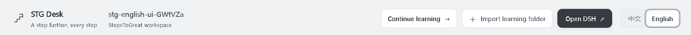<br>
      <sub><strong>v0.3.20 Instant 中文 / English Switch.</strong> Updates labels, dialogs, and detached/floating windows immediately without reloading or altering typed drafts and lesson text.</sub>
    </td>
  </tr>
  <tr>
    <td width="50%" valign="top">
      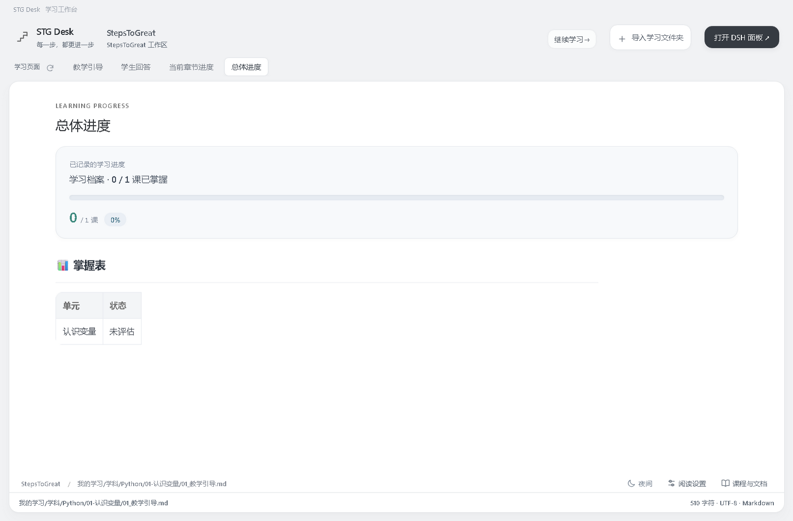<br>
      <sub><strong>Verifiable Learning Progress.</strong> Reads chapter handoffs, course roadmaps, and recorded mastery tables straight from your study profile and refreshes automatically when your tutor updates them.</sub>
    </td>
    <td width="50%" valign="top">
      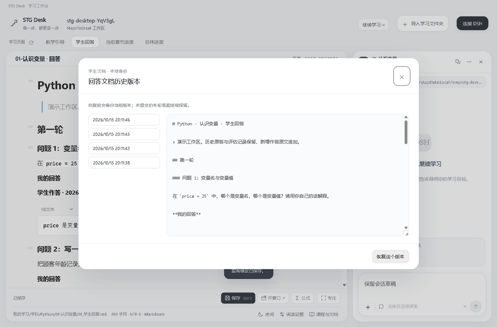<br>
      <sub><strong>Automatic Backup & Restore.</strong> Every save snapshots the previous file into <code>.stg-desk/backups/</code> (default 20 versions, 5–100 configurable) with side-by-side preview before restoring.</sub>
    </td>
  </tr>
</table>

> All screenshots use demo workspaces and test drafts—no real learner records or live model responses are included.

---

## 30-Second Quick Start

1. Download `STG-Desk-<version>-Windows.exe` from the [latest release](https://github.com/wildcat430524/STG-Desk/releases/latest) and run it—no Node.js or Electron setup required.
2. Click **「导入学习文件夹」** (Import learning folder) or drag your `StepsToGreat` folder directly into the window.
3. Click **「继续学习」** (Continue learning) for the active lesson or **「选择课程」** (Choose lesson) to browse courses and switch `第N轮` rounds.
4. Enter answers beside the lesson and press `Ctrl+S` or click Save to write cleanly into Markdown.

<p align="center">
  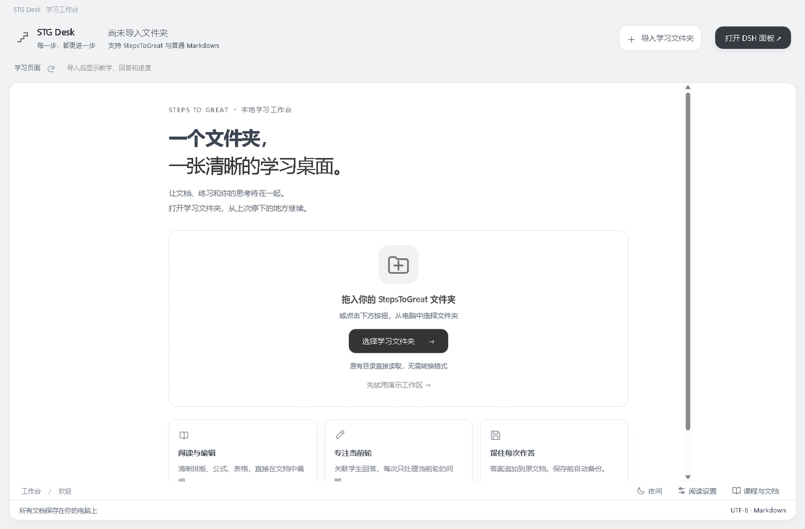
</p>

- **No study folder yet?** Try the [bundled demo lessons](demo/StepsToGreat) right from the welcome screen, or grab the [complex-content showcase ZIP](https://github.com/wildcat430524/STG-Desk/releases/download/v0.3.20/STG-Desk-0.3.20-EditorShowcase.zip) (`EditorShowcase` featuring Java 17+, Python, TS, SQL, and LaTeX matrices).

<details>
<summary><strong>Study directory layout & document pairing</strong></summary>

```text
StepsToGreat/
├─ README.md
└─ 我的学习/
   ├─ 00-学习档案.md
   └─ 学科/
      └─ Python/
         └─ 01-认识变量/
            ├─ 01_教学引导.md
            └─ 01_学生回答.md
```

Teaching and student documents in the same lesson folder pair by filename prefix, and the learning profile's handoff status points to the active lesson.

</details>

---

## DSH Integration

When you want AI evaluation or discussion, start **DeepSeek Harness Desktop** (keep its main window open), open the DSH panel in STG Desk, and click Connect:

<table>
  <tr>
    <td width="50%" valign="top">
      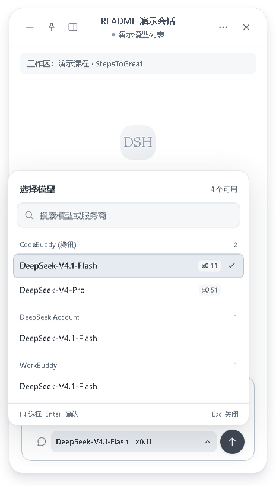<br>
      <sub><strong>Docked Panel or Always-on-Top Floating Window.</strong> Pop DSH out into a compact floating window while preserving the active session, model, and input draft.</sub>
    </td>
    <td width="50%" valign="top">
      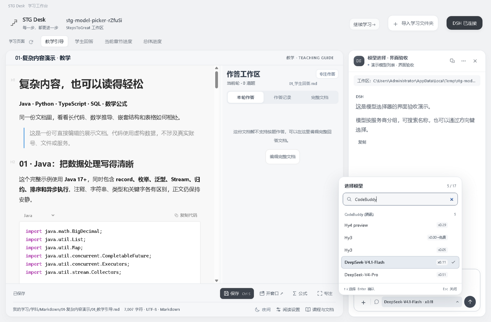<br>
      <sub><strong>Provider Search & Automatic Course Context.</strong> Search models by provider with keyboard navigation and price badges; messages automatically attach saved lesson, answer, profile, and rule files.</sub>
    </td>
  </tr>
</table>

> Your local DSH manages all accounts, quotas, and model catalogs—STG Desk never copies keys or credentials. Connecting STG Desk to DSH does not require installing `dsh-stg-learning`.

<details>
<summary><strong>DSH port and environment configuration (default http://127.0.0.1:19387)</strong></summary>

Verified against DSH Desktop **0.2.0-rc.2**. To point STG Desk at a custom local port or config directory:

```powershell
$env:STG_DSH_DESKTOP_URL = 'http://127.0.0.1:19387'
$env:DSH_HOME = 'C:\YourDSHConfig'
& 'C:\YourAppFolder\STG-Desk-<version>-Windows.exe'
```

Only localhost HTTP addresses are accepted, and desktop authorization stays inside the Electron main process.

</details>

---

## Data Safety & Backups

| Data | Location & Protection |
| :--- | :--- |
| Teaching, answers & profile | Saved directly to original folder Markdown after version check and atomic temp-file swap |
| History snapshots | `.stg-desk/backups/` inside the study folder (default 20 versions, 5–100 configurable) |
| Unsaved drafts | Auto-saved ~250 ms after typing pauses into system app settings; never overwrites disk files silently |
| DSH sessions & models | Managed locally by DeepSeek Harness |

---

## StepsToGreat Ecosystem

<p align="center">
  <picture>
    <source media="(prefers-color-scheme: dark)" srcset="docs/assets/ecosystem-en-dark.png">
    <source media="(prefers-color-scheme: light)" srcset="docs/assets/ecosystem-en-light.png">
    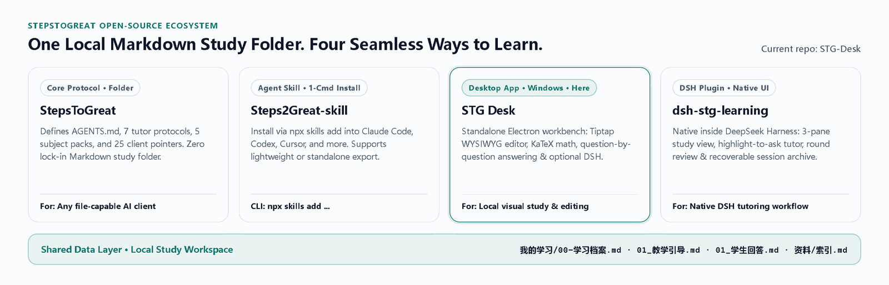
  </picture>
</p>

| Repository | Role | Best For |
| :--- | :--- | :--- |
| [StepsToGreat](https://github.com/wildcat430524/StepsToGreat/blob/main/README.en.md) | Open protocol & portable folder | Opening a local study folder in Codex, Claude, Cursor, etc. |
| [Steps2Great-skill](https://github.com/wildcat430524/Steps2Great-skill/blob/main/README.en.md) | Agent Skill (`npx skills add`) | One-command setup in Agent Skills clients or standalone export |
| **STG Desk** (this repo) | Windows desktop workbench | WYSIWYG reading, KaTeX math, question-by-question answering & backups |
| [dsh-stg-learning](https://github.com/wildcat430524/dsh-stg-learning) | DeepSeek Harness plugin | Native 3-pane workspace with highlight-to-ask tutor inside DSH |

---

## FAQ

<details>
<summary><strong>Can I use STG Desk without DSH?</strong></summary>

Yes—reading, WYSIWYG editing, KaTeX/code rendering, question-by-question answering, and backup recovery all work completely offline. Only sending AI messages requires a running local DSH Desktop host.

</details>

<details>
<summary><strong>Which file formats are supported?</strong></summary>

UTF-8 Markdown / TXT up to 8 MB per file (including BOM and CRLF), plus workspace-local images (remote images disabled by default; raw HTML rendering disabled). PDF and DOCX are out of scope; Mermaid stays as code blocks.

</details>

<details>
<summary><strong>Why does Windows show an unsigned-app prompt?</strong></summary>

Portable builds are currently unsigned. Always download from this repository's [Releases](https://github.com/wildcat430524/STG-Desk/releases) and verify with the included `SHA256SUMS.txt`.

</details>

---

## Development, Build & Contributing

Requires **Node.js 22.12+** (CI uses Node.js 24).

```powershell
git clone https://github.com/wildcat430524/STG-Desk.git
cd STG-Desk
npm ci
npm start
```

<details>
<summary><strong>Expand test commands, build scripts, and source layout</strong></summary>

| Command | Purpose |
| :--- | :--- |
| `npm run dev` | Start Vite UI preview (browser lacks desktop file system access) |
| `npm run build` | Build frontend into `dist/` |
| `npm test` | Run parsing, navigation, save, draft, DSH protocol, and editor tests |
| `npm run test:desktop` | Build and run Electron desktop smoke suite (unset `ELECTRON_RUN_AS_NODE` first) |
| `npx electron tests/english-ui.cjs` | Verify bilingual UI switch, persistence & detached window sync |
| `npx electron tests/answer-layout-ui.cjs` | Verify question switching, draft recovery & focused answering |
| `npx electron tests/model-picker-ui.cjs` | Verify model search, switch rollback & floating zoom |
| `npm run dist` | Package portable `release/STG-Desk-<version>-Windows.exe` |

```text
electron/          Desktop windows, IPC, DSH control, detached docs
src/               Study views, answer workspace, Tiptap editor, CSS
lib/               Navigation, parser, atomic saving, drafts, DSH service
tests/             Unit tests & Electron UI checks
demo/              Demo workspaces (StepsToGreat, EditorShowcase)
docs/              Screenshots, visual assets, editor notes & releases
.github/workflows/ Windows verification, build, and release workflows
```

Powered by **Tiptap / ProseMirror**, **markdown-it**, **KaTeX**, **DOMPurify**, and **highlight.js** (Atom One Light/Dark, BSD-3-Clause). See [editor research](docs/editor-research.md) and [rendering handoff](docs/editor-rendering-handoff.md).

</details>

Issues and pull requests are welcome! If STG Desk helps your learning, please consider leaving a ⭐ Star. [Report an issue](https://github.com/wildcat430524/STG-Desk/issues)

## License

New project code is licensed under [MIT](LICENSE). Third-party notices are listed in [THIRD-PARTY-NOTICES.md](THIRD-PARTY-NOTICES.md) and dependency LICENSE files.
