<div align="center">

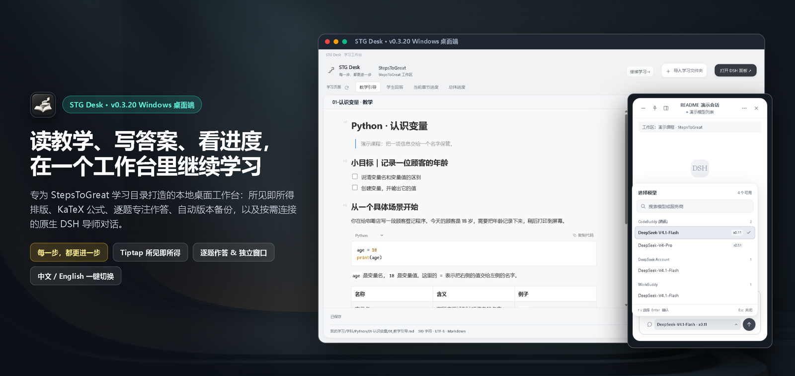

<h1>STG Desk</h1>

<p><strong>每一步，都更进一步。面向 <a href="https://github.com/wildcat430524/StepsToGreat">StepsToGreat</a> 学习目录的 Windows 本地桌面工作台。</strong></p>

<p>
  <a href="https://github.com/wildcat430524/STG-Desk/releases/latest"></a>
  <a href="https://github.com/wildcat430524/STG-Desk/actions/workflows/ci.yml"></a>
  <a href="https://github.com/wildcat430524/STG-Desk/releases"></a>
  
  <a href="LICENSE"></a>
</p>

<p>
  <strong><a href="https://github.com/wildcat430524/STG-Desk/releases/latest">下载 Windows 便携版 (v0.3.21)</a></strong> ·
  <a href="#界面功能全景">界面全景</a> ·
  <a href="#本地优先架构">架构与安全</a> ·
  <a href="#30-秒快速上手">快速开始</a> ·
  <a href="#dsh-原生协作">DSH 协作</a> ·
  <a href="#stepstogreat-开源生态">生态全家桶</a>
</p>

<p><strong>简体中文</strong> | <a href="README.en.md">English</a></p>

</div>

---

STG Desk 让纯 Markdown 驱动的自学工作流拥有顺手的桌面界面：直接打开本地 **StepsToGreat** 学习文件夹，从档案自动定位当前课程，在教学文档旁逐题作答、查看历轮反馈与总体掌握进度；需要 AI 批改或提问时，按需连接本机 **DeepSeek Harness（DSH）**，继续使用原生学习会话。

> **本地优先、零锁定**：阅读、编辑和作答可完全离线独立使用，直接保存回原目录的 Markdown 文件。文档对应 [v0.3.21](https://github.com/wildcat430524/STG-Desk/releases/tag/v0.3.21)（[查看全部发布说明](https://github.com/wildcat430524/STG-Desk/releases)）。

---

## 本地优先架构

<p align="center">
  <picture>
    <source media="(prefers-color-scheme: dark)" srcset="docs/assets/architecture-zh-dark.png">
    <source media="(prefers-color-scheme: light)" srcset="docs/assets/architecture-zh-light.png">
    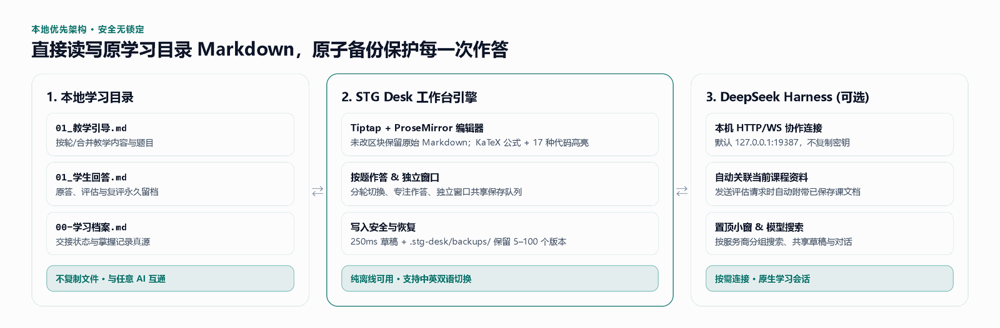
  </picture>
</p>

- **不复制资料**：导入学习文件夹即直接读写原目录 Markdown，与 Codex / Claude Code / DSH 等任意学习 Agent 互通。
- **双语界面与多版本 DSH 适配**：顶栏随时切换 **中文 / English**（状态本机记住、多窗口同步、不刷新页面也不丢草稿）；DSH 协作自动探测 0.1.x / 0.2.0 / 0.2.1 / 0.2.2+ 本地动态端口并保持断线重连与上下文去重。

---

## 界面功能全景

<table>
  <tr>
    <td width="50%" valign="top">
      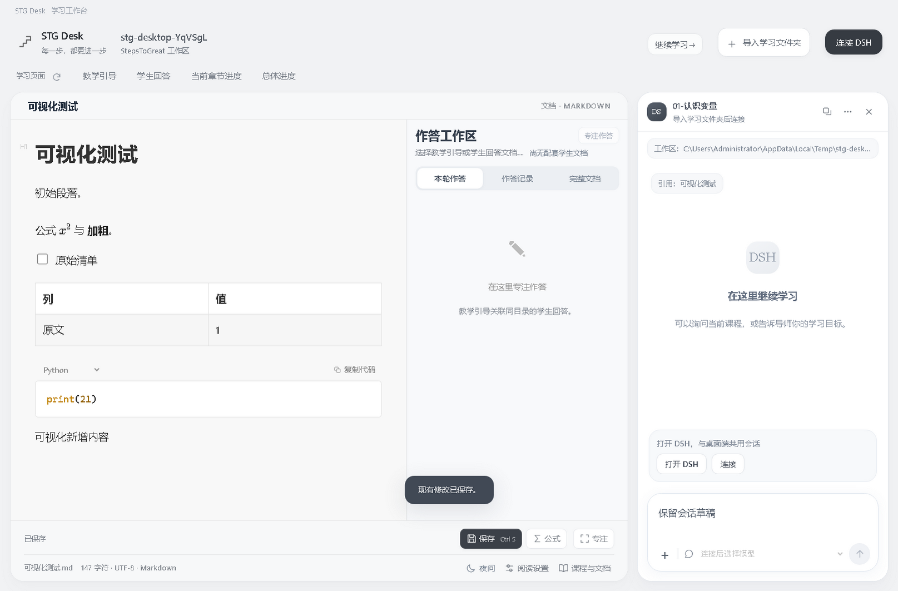<br>
      <sub><strong>所见即所得阅读编辑。</strong>点击标题、列表、表格或行内公式直接编辑，未修改区块严格保留原始 Markdown。支持阅读宽度、字号、夜间主题与 <code>Esc</code> 专注模式。</sub>
    </td>
    <td width="50%" valign="top">
      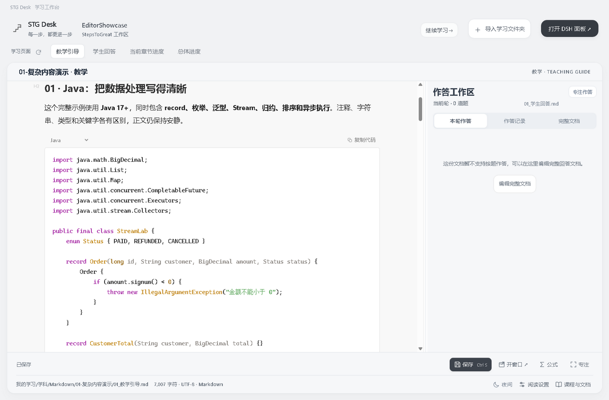<br>
      <sub><strong>17 种语法高亮与一键复制。</strong>Java / Python / TS / SQL / Rust 等代码块采用与预览一致的 Atom One Light/Dark 配色，工具条绝不污染 Markdown 原文。</sub>
    </td>
  </tr>
  <tr>
    <td width="50%" valign="top">
      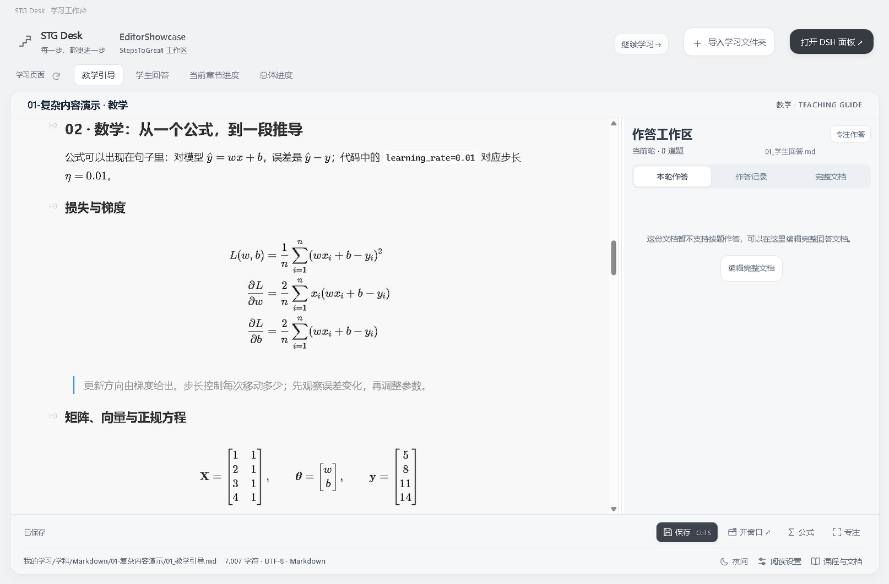<br>
      <sub><strong>KaTeX 数学公式就地校验。</strong>支持 <code>$...$</code> 行内公式与 <code>$$...$$</code> 独立推导块，插入弹窗实时预览并检查语法，双击已有公式修改源式。</sub>
    </td>
    <td width="50%" valign="top">
      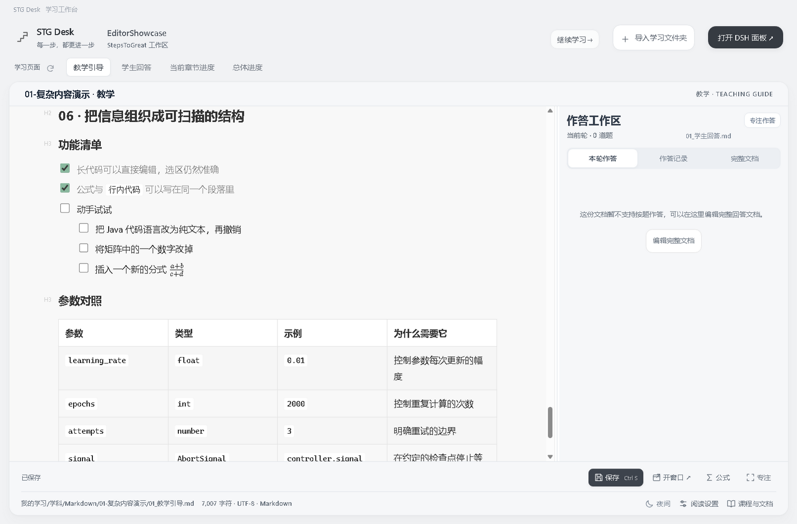<br>
      <sub><strong>复杂内容清晰排版。</strong>左侧留白标注 <code>H1</code>/<code>H2</code>/<code>H3</code> 层级，任务清单、嵌套列表与数据表格保持可编辑（可用仓库内置 <code>demo/EditorShowcase</code> 体验）。</sub>
    </td>
  </tr>
  <tr>
    <td width="50%" valign="top">
      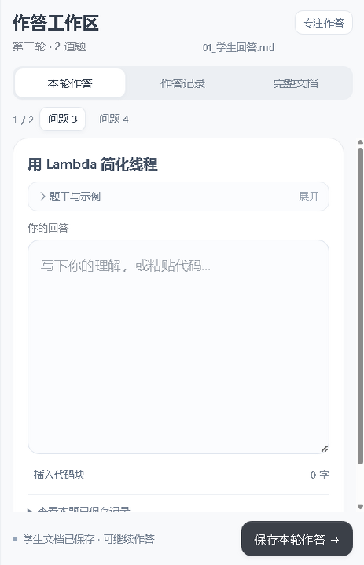<br>
      <sub><strong>教学旁逐题作答。</strong>支持切题保留草稿、折叠/展开长题干、插入代码块以及「专注作答」放大输入，并可随时切到「作答记录」与「完整文档」。</sub>
    </td>
    <td width="50%" valign="top">
      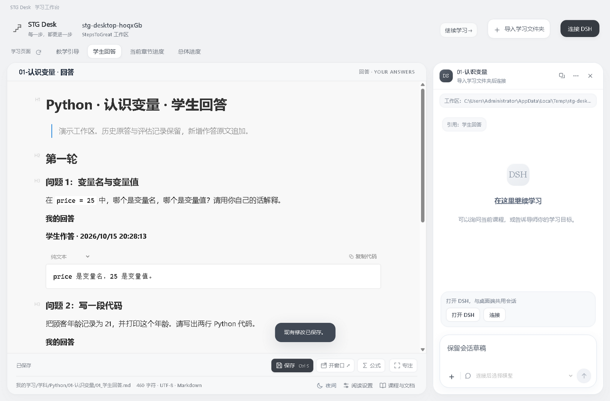<br>
      <sub><strong>一键写入、原答可核对。</strong>点击「保存本轮作答」或 <code>Ctrl+S</code> 将本轮答案与文档编辑一次落盘，绝不自动篡改掌握表或交接状态。</sub>
    </td>
  </tr>
  <tr>
    <td width="50%" valign="top">
      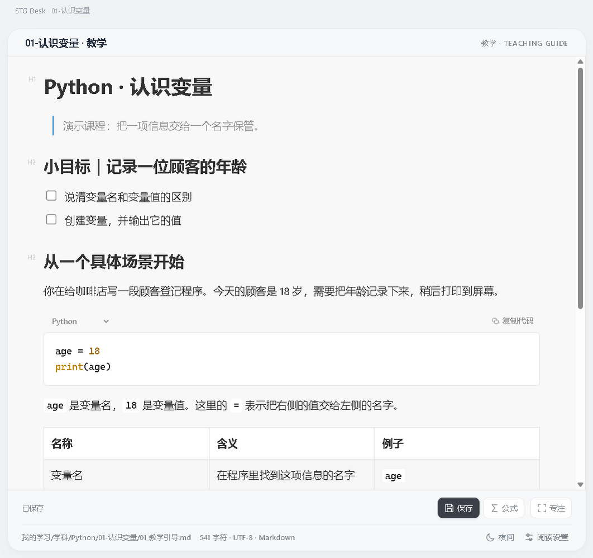<br>
      <sub><strong>独立窗口分屏学习。</strong>点击「开窗口 ↗」将教学文档或学生文档移出主窗口，一边对照阅读一边专注作答，多窗口共享保存队列与版本校验。</sub>
    </td>
    <td width="50%" valign="top">
      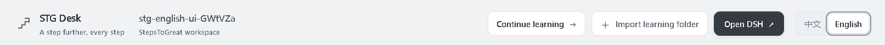<br>
      <sub><strong>v0.3.20 中英界面无缝切换。</strong>顶栏点击即可切换，独立窗口与 DSH 小窗同步生效；不重载页面，也不修改已输入的答案草稿或课程内容。</sub>
    </td>
  </tr>
  <tr>
    <td width="50%" valign="top">
      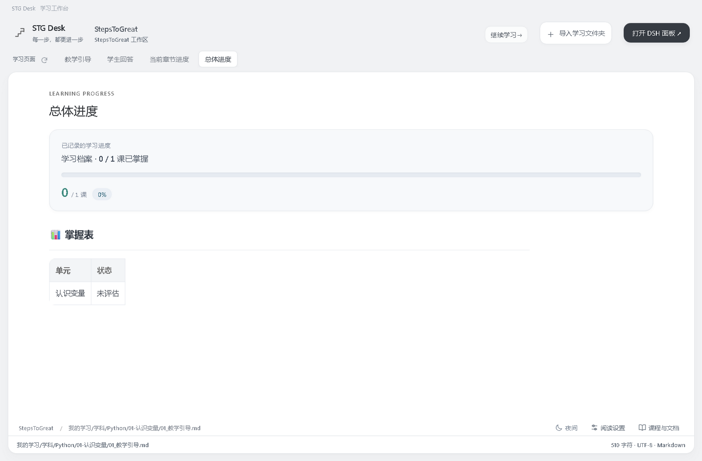<br>
      <sub><strong>学习进度有据可查。</strong>直接解析学习档案中的交接状态、课程路线与掌握记录表，导师更新记录后自动刷新展示。</sub>
    </td>
    <td width="50%" valign="top">
      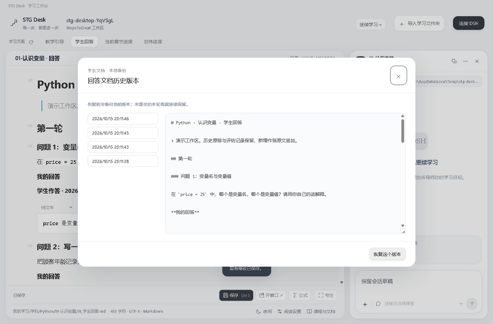<br>
      <sub><strong>自动备份与历史预览恢复。</strong>每次保存前自动在 <code>.stg-desk/backups/</code> 备份旧版（默认保留 20 个版本，可设 5–100），恢复前先预览原文。</sub>
    </td>
  </tr>
</table>

> 以上截图均使用仓库内置演示课程与测试草稿，不包含真实学习记录或模型回复。

---

## 30 秒快速上手

1. 前往 [最新发布页](https://github.com/wildcat430524/STG-Desk/releases/latest) 下载 `STG-Desk-<版本号>-Windows.exe`，双击即用（便携免安装，无需配置 Node.js 或 Electron）。
2. 点击 **「导入学习文件夹」** 或直接从资源管理器拖入你的 `StepsToGreat` 根目录。
3. 点击 **「继续学习」** 进入当前课，或通过 **「选择课程」** 切换章节（含分轮 `第N轮_教学引导.md` 箭头切换）。
4. 在右侧逐题填写答案，按 `Ctrl+S` 或点 **「保存本轮作答」** 写入 Markdown。

<p align="center">
  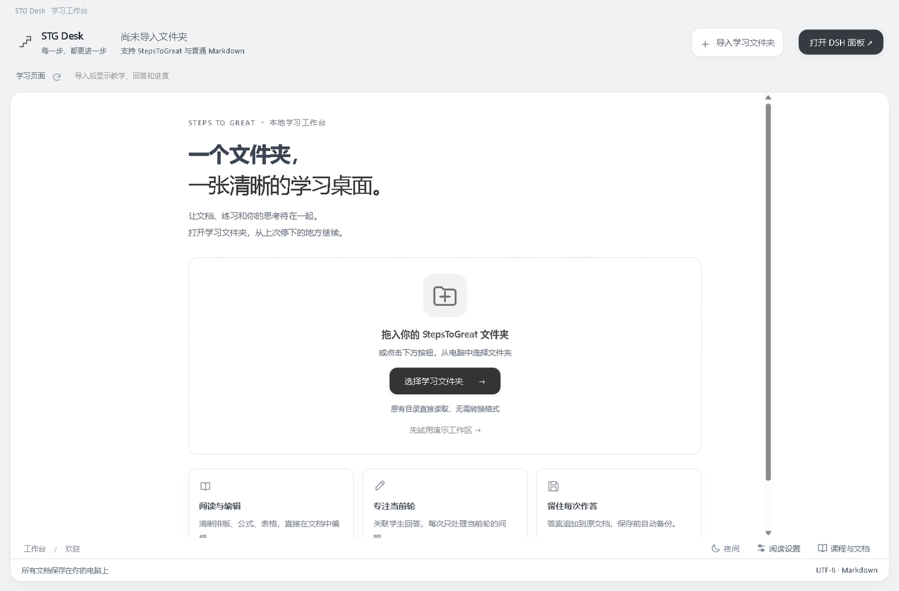
</p>

- **没有现成资料？** 欢迎页一键体验内置 [演示课程](demo/StepsToGreat)，或下载 [复杂内容演示 ZIP](https://github.com/wildcat430524/STG-Desk/releases/download/v0.3.21/STG-Desk-0.3.21-EditorShowcase.zip) 解压导入 `EditorShowcase`（含 Java 17+ / Python / TS / SQL 与 LaTeX 矩阵）。

<details>
<summary><strong>查看标准学习目录与文档配对约定</strong></summary>

```text
StepsToGreat/
├─ README.md
└─ 我的学习/
   ├─ 00-学习档案.md
   └─ 学科/
      └─ Python/
         └─ 01-认识变量/
            ├─ 01_教学引导.md
            └─ 01_学生回答.md
```

教学引导与学生回答使用相同前缀并放在同一课程目录下即可自动配对；当前课由学习档案的交接状态决定。

</details>

---

## DSH 原生协作

需要 AI 导师点评本轮答案时，启动本机 **DeepSeek Harness 桌面端**（保持应用运行或托盘驻留即可），在 STG Desk 右上角点击「打开 DSH 面板」→「连接」：

<table>
  <tr>
    <td width="50%" valign="top">
      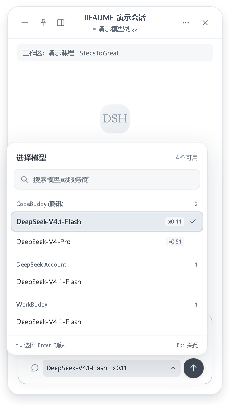<br>
      <sub><strong>侧边面板 & 置顶独立小窗。</strong>可随时切出为置顶悬浮窗，面板与小窗共享同一段学习会话、当前模型和输入草稿。</sub>
    </td>
    <td width="50%" valign="top">
      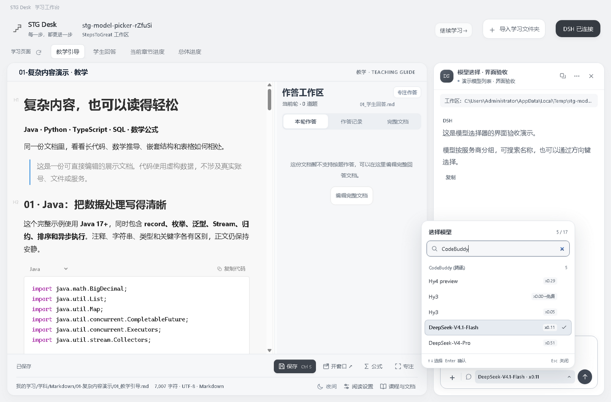<br>
      <sub><strong>按服务商搜索模型与自动带课上下文。</strong>支持键盘方向键/搜索过滤、价格标记；每次发送自动关联已保存的教学引导、学生回答、档案与学习规则。</sub>
    </td>
  </tr>
</table>

> 模型目录、账号与额度完全由你本机的 DSH 管理，STG Desk 不复制任何密钥或凭据。连接 DSH 也不要求额外安装 `dsh-stg-learning` 插件。

<details>
<summary><strong>DSH 多版本自动发现与环境变量配置（支持 0.1.x / 0.2.0 / 0.2.1 / 0.2.2+）</strong></summary>

已适配 **DSH 0.1.x、0.2.0（默认 `19387` 端口）、0.2.1 / 0.2.2+（随机本地端口 `--port 0` 与托盘驻留）** 以及本地 `dsh web` 会话，通常无需手动指定端口。若本机使用自定义端口或配置目录，启动前设置对应环境变量即可：

```powershell
$env:STG_DSH_DESKTOP_URL = 'http://127.0.0.1:19387'
$env:DSH_HOME = 'C:\你的DSH配置目录'
& 'C:\你的软件目录\STG-Desk-<版本号>-Windows.exe'
```

仅允许连接本机 HTTP 地址，连接授权在 Electron 主进程读取。

</details>

---

## 数据安全与备份机制

| 数据类型 | 保存位置与保护机制 |
| :--- | :--- |
| 教学引导、学生回答与档案 | 直接读写原学习目录 Markdown，保存前校验文件版本并经临时文件原子替换 |
| 历史版本快照 | 学习目录 `.stg-desk/backups/`（默认保留 20 个版本，可设 5–100）；并发外部修改可自动合并或备份冲突旧版 |
| 未保存输入草稿 | 停顿约 250ms 自动暂存至系统应用设置目录，独立窗口互不干扰，恢复时绝不盲目覆盖原盘文件 |
| DSH 对话与模型配置 | 由本机 DSH 原生管理 |

---

## StepsToGreat 开源生态

<p align="center">
  <picture>
    <source media="(prefers-color-scheme: dark)" srcset="docs/assets/ecosystem-zh-dark.png">
    <source media="(prefers-color-scheme: light)" srcset="docs/assets/ecosystem-zh-light.png">
    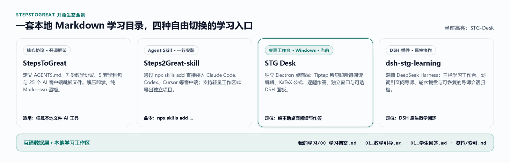
  </picture>
</p>

| 项目 | 角色定位 | 适用场景 |
| :--- | :--- | :--- |
| [StepsToGreat](https://github.com/wildcat430524/StepsToGreat) | 开放教学协议与文件夹框架 | 用任意 AI 工具（Codex / Claude / Cursor 等）打开目录即学 |
| [Steps2Great-skill](https://github.com/wildcat430524/Steps2Great-skill) | Agent Skill (`npx skills add`) | 一行命令装入常用 AI 客户端，支持轻量目录或导出独立项目 |
| **STG Desk**（本仓库） | Windows 独立桌面工作台 | 偏爱所见即所得排版、公式、逐题专注作答与历史版本备份 |
| [dsh-stg-learning](https://github.com/wildcat430524/dsh-stg-learning) | DeepSeek Harness 原生插件 | 直接在 DSH 内部同屏完成阅读、划词提问、作答与会话管理 |

---

## 常见问题

<details>
<summary><strong>没有安装 DSH 可以独立使用 STG Desk 吗？</strong></summary>

完全可以。阅读、Markdown 所见即所得编辑、公式/代码排版、逐题作答保存和历史备份全部离线可用；仅发送 AI 消息时需要本机运行 DSH 桌面端。

</details>

<details>
<summary><strong>支持哪些文件格式？</strong></summary>

支持 UTF-8 Markdown / TXT（单文件上限 8 MB，兼容 BOM 与 CRLF），支持加载工作区内本地图片（远程图片默认禁用，原始 HTML 渲染关闭）。PDF / DOCX 不在解析范围，Mermaid 保留为代码块。

</details>

<details>
<summary><strong>Windows 打开便携版时提示未签名怎么办？</strong></summary>

当前便携版尚未做商业代码签名，请务必从本仓库 [Releases](https://github.com/wildcat430524/STG-Desk/releases) 下载，并使用附件 `SHA256SUMS.txt` 校验文件哈希。

</details>

---

## 开发、构建与贡献

需要 **Node.js 22.12+**（CI 使用 Node.js 24）。

```powershell
git clone https://github.com/wildcat430524/STG-Desk.git
cd STG-Desk
npm ci
npm start
```

<details>
<summary><strong>展开查看测试命令、构建产物与源码目录结构</strong></summary>

| 命令 | 用途 |
| :--- | :--- |
| `npm run dev` | 启动 Vite 前端界面预览（浏览器模式不含桌面文件读写） |
| `npm run build` | 构建前端产物至 `dist/` |
| `npm test` | 运行解析、导航、保存、草稿、DSH 协议与高亮/公式单元测试 |
| `npm run test:desktop` | 构建并运行 Electron 桌面冒烟验收（需清除 `ELECTRON_RUN_AS_NODE=1`） |
| `npx electron tests/english-ui.cjs` | 验证中英文切换、多窗口同步与偏好恢复 |
| `npx electron tests/answer-layout-ui.cjs` | 验证切题、草稿恢复、专注作答与整轮保存 |
| `npx electron tests/model-picker-ui.cjs` | 验证模型搜索、切换失败恢复与小窗缩放 |
| `npm run dist` | 打包生成便携单文件 `release/STG-Desk-<版本号>-Windows.exe` |

```text
electron/          桌面主进程、IPC、DSH 控制与独立文档窗口
src/               学习界面、作答工作区、Tiptap 编辑器与样式
lib/               课程导航、文档解析、原子保存、草稿与 DSH 服务
tests/             单元测试与 Electron UI 验收脚本
demo/              演示课程（StepsToGreat、EditorShowcase）
docs/              截图、视觉资产、编辑器调研与发布说明
.github/workflows/ Windows CI 验证、构建与发布流程
```

编辑器基于 **Tiptap / ProseMirror**、**markdown-it**、**KaTeX**、**DOMPurify** 与 **highlight.js**（Atom One Light/Dark，BSD-3-Clause）。详见 [编辑器调研](docs/editor-research.md) 与 [渲染整合说明](docs/editor-rendering-handoff.md)。

</details>

欢迎提交 [Issue](https://github.com/wildcat430524/STG-Desk/issues) 或 Pull Request！如果 STG Desk 对你的学习有帮助，请点一颗 ⭐ Star 支持。

## 许可证

本项目新增代码采用 [MIT](LICENSE)。第三方组件许可见 [THIRD-PARTY-NOTICES.md](THIRD-PARTY-NOTICES.md) 及依赖各自的 LICENSE。
